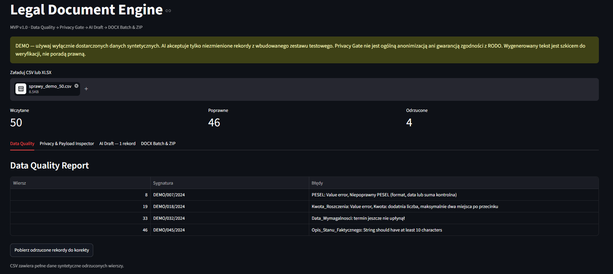
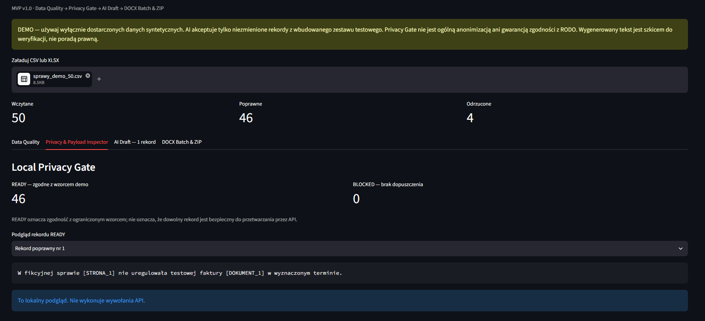
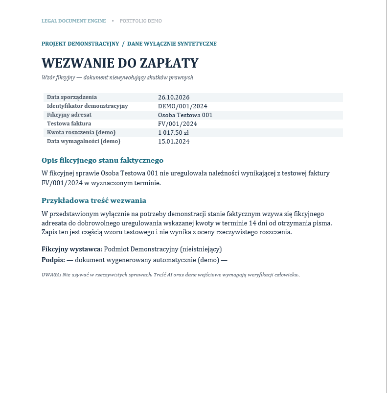

# Legal Document Engine

**Privacy-aware legal document automation | Python · Streamlit · Gemini API · Pydantic · DOCX · SQL Server**

## 📄 Project Overview

Legal Document Engine is a **local, demonstration-only application** that turns structured case records into batches of editable Word documents. It combines data validation, a restrictive privacy gate, optional AI-assisted drafting, template-based DOCX generation, and aggregate processing telemetry.

The current MVP produces **fictional pre-litigation payment demand letters** (*przedsądowe wezwania do zapłaty*) from a predefined synthetic dataset. It is designed to demonstrate a controlled document-processing pipeline—not to generate production-ready legal correspondence or process real case files.

## 🖥️ Application Preview









## 🎯 Business Value & Use Case

Repetitive legal-document workflows often begin with spreadsheets containing incomplete, inconsistent, or sensitive information. Simply connecting a language model to those records can amplify data-quality issues and unnecessarily expose identifying details.

This project explores a more controlled approach:

- **Validate before processing:** Reject malformed or incomplete records before document generation.
- **Minimize outbound data:** Replace supported identifiers with placeholders locally and inspect the payload before an optional API call.
- **Separate AI from document structure:** Use Gemini for a limited narrative paragraph while Python and a Word template control the rest of the document.
- **Scale deterministic output:** Generate many editable `.docx` files from one validated batch and package them into a single ZIP.
- **Measure processing without storing case content:** Optionally record aggregate run metrics in SQL Server.

## ⚙️ Core Features

| Component | Implementation |
|---|---|
| **Data Quality Gate** | CSV/XLSX import with Pandas and record-level Pydantic validation; checks include required fields, positive claim amounts, dates, PESEL structure/checksum, and duplicate detection. |
| **Privacy Gate** | Local placeholder substitution, restricted acceptance of the bundled synthetic demo records, and a preview of the text prepared for the API. |
| **AI Drafting** | Optional Gemini-powered rewriting of a single, constrained legal-style paragraph; the model does not generate the entire letter. |
| **Response Integrity** | Structured-response validation and checks that expected placeholders remain intact before local replacement. |
| **DOCX Generation** | `docxtpl`-based Word template containing deterministic fields and a reviewed narrative paragraph. |
| **Batch Export** | Multiple editable Word files, a status report, and a readme packaged with `zipfile`. |
| **Telemetry** | Optional SQL Server logging of aggregate processing counts, execution time, model information, and token usage. |

## 🏗️ Technical Architecture

```text
CSV / XLSX (synthetic demo cases)
            │
            ▼
Data Quality Gate (Pandas + Pydantic)
            │
            ▼
Local Privacy Gate ──► Payload Inspector
            │
            ├── Offline drafting (no API call)
            │
            └── Gemini drafting (approved placeholder text only)
                         │
                         ▼
               Response / token validation
                         │
                         ▼
                Local placeholder restoration
                         │
                         ▼
           DOCX template rendering (docxtpl)
                         │
                         ▼
                ZIP + batch_report.csv
                         │
                         └──► Optional SQL telemetry (aggregates only)
```

### Engineering Decisions & Trade-offs

**1. Fail-closed demo privacy controls.** The current Privacy Gate accepts only the supported, locally verified synthetic scenario. Unrecognized narratives are blocked rather than assumed safe. This is intentionally **not** a general-purpose PII detection or anonymization solution.

**2. Placeholder integrity before re-identification.** The application validates the model's response and checks required tokens before restoring synthetic identifiers in memory. This reduces the risk of a malformed AI response silently producing incorrect documents.

**3. One shared AI request for the demo batch.** All 46 accepted sample records have the same narrative after placeholder substitution. As a result, the Gemini mode can use **one shared drafting request** and restore each record's synthetic values locally. This optimization does **not** generalize to cases with materially different narratives.

**4. Deterministic legal-document structure.** Names, dates, amounts, and the document layout are supplied by validated data and the Word template—not invented by the language model. Generated wording still requires human review.

**5. Content-free telemetry.** SQL Server records operational aggregates only, without storing names, PESEL numbers, case descriptions, prompts, AI responses, or placeholder maps. SQL connectivity is optional and does not need to be available for ZIP generation.

## 🧪 Demo Dataset & Expected Results

The repository includes `data/sprawy_demo_50.csv`, a synthetic 50-record dataset with four deliberately invalid entries.

| Validation / output | Expected result |
|---|---:|
| Imported records | **50** |
| Valid records | **46** |
| Rejected records | **4** |
| Privacy Gate: READY | **46** |
| Privacy Gate: BLOCKED (among valid demo records) | **0** |
| Generated Word documents (Offline mode) | **46** |
| Other ZIP files | `batch_report.csv`, `README.txt` |

The resulting ZIP contains **48 files**: 46 demonstration letters and two supporting files. The letters are visibly labeled as demonstration drafts; PESEL numbers are not inserted into the generated letters.

## 🚀 Getting Started

**Prerequisites:** Python, a local environment capable of running Streamlit, and Microsoft Word or a compatible DOCX viewer to inspect results. Gemini API credentials are required **only** for AI mode; SQL Server is optional.

```powershell
# From the project root
python -m venv .venv
.\.venv\Scripts\python.exe -m pip install -r requirements.txt

# Run automated checks
.\.venv\Scripts\python.exe -m pytest -v

# Start the application
.\.venv\Scripts\python.exe -m streamlit run app.py
```

In Streamlit:

1. Upload `data/sprawy_demo_50.csv` and review Data Quality results.
2. Inspect the **Privacy & Payload Inspector** to see which records are eligible for processing.
3. Open **DOCX Batch & ZIP**, select **Offline**, and generate the document package.
4. Download the ZIP and inspect several `.docx` documents.
5. Optionally configure Gemini API credentials and repeat with **Gemini** mode using the **synthetic data only**.

To enable AI mode, copy `.env.example` to `.env` and set your `GEMINI_API_KEY` and `GEMINI_MODEL`. **Never commit `.env` or API keys.**

### Optional SQL Server Telemetry

Run `sql/schema.sql` in SSMS. Then configure your local `.env`:

```dotenv
SQL_LOGGING_ENABLED=true
SQL_SERVER=.\SQLEXPRESS
SQL_DATABASE=LegalDocumentEngineDB
SQL_DRIVER=ODBC Driver 17 for SQL Server
```

Inspect aggregate runs in SSMS:

```sql
USE LegalDocumentEngineDB;
SELECT TOP (20) *
FROM dbo.DocumentBatchRun
ORDER BY BatchRunID DESC;
```

## 🧰 Tech Stack

- **Language & UI:** Python, Streamlit
- **Data Processing & Validation:** Pandas, Pydantic
- **Generative AI:** Google Gemini API (`google-genai`)
- **Document Automation:** `docxtpl`, `python-docx`, `zipfile`
- **Database & Observability:** SQL Server, `pyodbc` (optional)
- **Quality Assurance:** `pytest`

## 🔐 Privacy, Legal & Technical Limitations

> **Portfolio demonstration only.** Use the bundled synthetic data—not actual court records, debt-collection files, or personal information. Output documents are fictional drafts, not legal advice or documents ready to send.

- **Pseudonymization is not anonymization.** Replacing known identifiers with tokens does not ensure that a narrative cannot identify an individual.
- The Privacy Gate is restricted to a known demonstration pattern; it **does not guarantee the detection of all personal data** or GDPR compliance.
- A structurally valid PESEL does not establish identity or prove that a number belongs only to a fictional person.
- Gemini mode contacts a third-party API; service-side processing and retention depend on the applicable provider terms and settings.
- AI-generated text can contain errors; no automatic legal or factual verification is claimed.
- The current version supports **one synthetic scenario, one document type, and one Word template**. It is not a production system for courts or law firms.

## ✅ Tests & Release Scope

The MVP was developed with **47 automated offline tests** covering validation, privacy controls, AI-response checks, and document-generation behavior. Tests do not require live Gemini API calls.

```powershell
python -m pytest -v
```

**v1.0 scope:** synthetic CSV/XLSX input, data-quality reporting, restrictive privacy checks, offline or optional Gemini-assisted drafting, editable DOCX batch output, ZIP export, and optional aggregate SQL telemetry.

**Possible future work (outside v1.0):** more document templates, broader synthetic scenarios, human approval workflows, improved privacy detection, and a Power BI operational dashboard.
